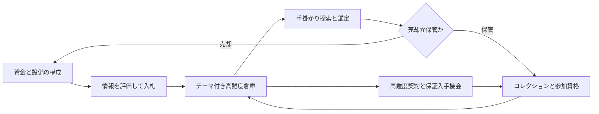

# LAST STORAGE｜エンドゲーム設計案

作成日：2026-11-12。状態：**設計提案／以下の新機能は未実装・バランス未検証**。

今回追加するのは本書と [実装計画](ENDGAME_ROADMAP.md) のみ。既存コード、設定、テスト、既存文書は変更しない。会社PCには開発ツールを導入せず、Codex Cloud / GitHubで設計・標準C++を進める。UE実行・ビルド・3D配置は後日の自宅PC作業とする。**UE5の正確なバージョンは未確定、UE動作は未検証**。

## 1. 既存実装と今回の位置付け

対象は接続された `HARU091500/game` のローカルチェックアウト。origin は `github.com/HARU091500/game.git`。調査時はローカルHEADにコミットがなく、既存38ファイルは未追跡だった。GitHubへの読み取り専用の `git ls-remote origin` は成功したが参照は返らず、リモートのmain/HEADのコミットは確認できなかった。本書はクラウド内の既存38ファイルを実際に読んで設計し、それらをGitHubへ保存済みとは扱わない。

| 調査した既存ファイル | 現在できること | 新設計との差分 |
|---|---|---|
| `Public/Economy/LastStorageEconomy.h` | 整数所持金、費用、取得、鑑定額、鑑定済み品の売却、二重売却拒否 | レアリティ・状態・真贋・保管・見積・手数料がない |
| `Public/Gameplay/LastStorageSession.h` | 入札→勝敗→収集→固定額鑑定→全品売却→終了 | 参加費なし、落選時無課金、全品売却が終了条件。保管と特殊ルールに非対応 |
| `Public/Progression/LastStorageEndgame.h` | 売却した種類の図鑑、記録、銅銀金契約、称号 | 発見と現在保有を区別せず、完了した勝利Sessionだけを登録する |
| `Public/LastStorageInspectable*.h` と調査Component | UE向けの調査対象・カメラ判定用コード | 個体ID、拾得・鑑定・真贋・進捗との接続は未実装 |
| `Data/mvp_economy.json`、`Tools/Unreal/warehouse_layout.json` | 1室・10種類・固定価格1750の仮データ | ランダム内容、相場、Tier、希少品の設定がない |
| `Examples/*.cpp`、`Tests/*`、クラウド用runner | テキスト試遊、標準C++の検証経路 | UEゲーム、保存・復元、長時間の試遊を示すものではない |

上記Publicの実パスは `Plugins/LastStorage/Source/LastStorageRuntime/Public/` 以下。`.uproject`、保存済み `.umap` / `.uasset` は存在しない。従来のC++64件・Python27件成功は [以前の検証記録](VALIDATION.md) であり、今回の新設計の動作・経済検証結果ではない。

既存の [ENDGAME.md](ENDGAME.md) は「全品売却・固定価格の小さな試作」の記録として残す。本書はその将来拡張案であり、新しい確率表や参加費が既存サンプルへ適用されたとは扱わない。Stage移行時に互換モードと新仕様を明示して切り替える。

## 2. 三本柱とプレイヤーの判断

資金は次の挑戦と設備へ投資し、希少品の保管には売却益を見送る機会費用がある。コレクションと難題の達成が、より情報の少ない高額倉庫を解放する。良い装備でも投資判断を誤ると赤字になり、少ない装備でも所有者の履歴や品物の特徴を読めば利益や希少品に近づける。

| 判断場面 | プレイヤーが使う知識・選択 | 結果に与える影響 |
|---|---|---|
| 入札前 | 所有者テーマ、箱・ラベル・出品履歴、情報の信頼度、残す運転資金 | 買わない判断、入札上限、必要装備が変わる |
| 設備選択 | 鑑定精度、情報量、売却手数料から同時に2系統を選ぶ | 偽物対策と利益率の両立には限界がある |
| 探索 | 刻印、修復跡、書類、空間の不整合、金庫の手掛かり | 価値の裏付けと隠し枠への到達率が変わる |
| 処分 | 換金して高額倉庫へ進むか、保管してセットを埋めるか | 流動資金と長期資格が相互に制約する |
| 契約 | 自分の得意な知識と資金でルールを選ぶ | 少額の安全運用と高リスクの希少品狙いを選べる |

「世界一のコレクター」はシングルプレイ内の到達称号。オンライン順位や他者との比較は導入しない。

## 3. 個人開発のコンテンツ予算

- 最初の検証は既存の1室・10種類のまま。異なる色だけを大量に集めさせて長時間化しない。
- Stage 2の小規模検証後、10種のメッシュ原型を流用し、銘・年代・来歴・刻印・説明の違いを持つ**30種類の収集定義**で試作する。レアリティごとに新規メッシュを要求しない。
- 長期版の候補は60定義・4テーマ・4コレクションセット。探索と判断の多様性を確認してから拡張し、60モデルや多数の巨大マップは前提にしない。
- テーマは「修理業者」「音楽家」「古物商」「研究収集家」。1室の配置テンプレートを入口、棚、主展示、隠し場所などの役割に分けて再利用する。
- 隠し金庫・二重底・書類ケースは少数の共通Blueprintで表現する。新素材は無料または商用利用可能なものだけを使い、導入時に [出典](ASSET_REGISTER.md) を確認する。今回は素材を追加しない。

20〜40時間程度の探索と収集を**検証目標の仮説**とする。現時点で達成を保証しない。短くても満足度のある攻略を認め、知識のあるプレイヤーを強制周回数で止めない。試作が反復作業になる場合は手掛かり・契約・配置の種類を改善し、確率を下げて埋め合わせない。

## 4. 進行と状態の境界

提案する進行は `拠点準備 → 固定された出品の下見 → 参加確定 → 入札 → 落札/落選 → 探索 → 拠点清算 → 結果確定`。

1. 拠点で設備と資金保護額を選ぶ。出品のOfferId、内容Seed、GenerationVersion、MarketSnapshot、ルール、保証枠を下見前に確定・保存し、参加前にその試行のRunIdも固定する。
2. 下見で表示された情報は品質と欠落理由も示す。「確認済み事実」「推定」「未調査」を区別する。高額品の正体・真贋を全表示しない。
3. 参加費・費用見込・最低手元資金を表示して参加を確定する。ブラックの参加費はこの時点で一度だけ支払う。
4. 入札金は予約する。増額時は予約の置換、落選時は解除、落札時だけ費用へ振り替える。参加費は落選しても戻らない。
5. 取得した品を、鑑定・売却・保管・明示的放棄に振り分ける。倉庫の品と所持品の二重所有を禁止する。
6. 必須目標が処理され、倉庫内の各個体が拠点へ移送済み・売却済み・放棄済みなら清算へ進む。**全品売却を新仕様の必須条件にしない**。未鑑定の封印保管も許可する。
7. 清算で実費・売上・保管・発見・契約結果を一つの結果票に確定し、Careerへ一度だけ反映する。閉じた結果票の再送では残高・報酬・記録を増やさない。

時間切れや途中撤退でも、取得済み品と未取得品の扱いを契約に従って確定し、支払い済み費用を消さない。契約失敗と通常収集の成果を分ける。普通の撤退で希少品を無条件没収するルールにはしない。

## 5. データモデル

表の型名は設計上の提案。C++の宣言やData Assetは今回は作成しない。

| データ | 主なフィールドと責務 |
|---|---|
| `ItemDefinitionV2` | `DefinitionId`、既存種類/メッシュ原型の `ArchetypeId`、名称、説明、Rarity、整数BaseValue、CollectionTags、DiscoveryRuleId、表示用ヒント、条件別出現候補 |
| `ItemInstanceV2` | 世界で一意のInstanceId、DefinitionId、AcquiredRunId、真のCondition、真のAuthenticity、来歴、生成スナップショット、現在のDisposition、鑑定記録 |
| `ItemKnowledge` | 発見済みフラグ、観察・推定・確定を区別するRevealMask、推定価値区間、確認した手掛かりID。真値をUIへ直接返さない |
| `CollectionEntry` | DefinitionIdごとの発見履歴、鑑定履歴、現在保有個体ID、セット条件。名称と原型IDだけで全コレクションを埋めない |
| `WarehouseTierDefinition` | 解放条件、参加費、最低入札、費用予算、保護残高、基準重み、候補プール、状態/偽物分布、配置テンプレート、イベント候補 |
| `DiscoveryRuleDefinition` | 必須手掛かり、設備や資格、配置ソケット、発見条件、保証対象。必要な手掛かりと報酬が同じ倉庫で循環依存しない |
| `ChallengeDefinitionV2` | ルール、適格Tier、参加条件、成功・失敗判定、互換タグ、報酬、実績の重複キー |
| `FacilityLoadout` | 購入済み設備、選択中の2系統、稼働点、強化段階、周回中の構成ロック |
| `CareerState` | 単一の所持金、予約額、保管品、図鑑、設備、資格、結果票の登録履歴、出品一覧、保証進捗、最高記録 |
| `RunManifest` / `RunReceipt` | 不変RunId、SeedとVersion、生成済み個体・配置・市場、費用・見積・処分・イベント監査、契約、確定済みフラグ |

OfferIdは出品内容、RunIdは参加試行、RewardReservationIdは保証品の予約を区別する。中断再開は同じRunIdを使う。契約失敗後の正当な再挑戦には新RunIdを発行するが、保証品の予約と対象は維持し、失敗した試行の費用を消さない。保証報酬は成功結果票の受領時に一度だけ渡し、失敗中に候補品だけを持ち逃げして複製しない。

アイテムの表示情報は「定義＋個体＋プレイヤーの知識」から組み立て、要求されたID・名称・レアリティ・基本価値・状態・真贋・分類・発見・保有・特殊条件を全て参照できるようにする。保有は `InWarehouse / Carried / Stored / Exhibited / Sold / Abandoned` の排他的状態とし、展示品を保管品と別の複製として扱わない。

真のAuthenticityは `Genuine / Replica / Forged`、プレイヤーの確認状態は `Unassessed / Estimated / Confirmed` と分離する。状態は0〜100の真値と、観察した区間を持つ。未知を「偽物」や「状態0」に置換しない。偽物でも材質・部品価値は残り得るが、本物限定セットの資格には使わない。

金額は既存と同じ非負int64の最小単位。確率・倍率は整数bps（10000＝100%）。IDは既存の小文字ASCII規則を維持し、名称にはローカライズを用いる。価格計算の中間乗算にもオーバーフロー検査を設け、丸め順をデータ版とともに固定する。

## 6. レアリティと基準出現率

### 6.1 六段階の役割

| レアリティ | 収集上の位置付け | 本物・良好時のBaseValue帯の初期案 |
|---|---|---:|
| Common | 日常品、部品、テーマの文脈を読む材料 | 30〜300 |
| Uncommon | 年代や型式を知ると利幅が出る品 | 150〜1000 |
| Rare | セット形成と上位資格の入口 | 600〜5000 |
| Epic | 来歴調査・設備選択の価値が大きい品 | 2500〜15000 |
| Legendary | 明示された伝説セットの構成品 | 10000〜60000 |
| Mythic | 特殊発見条件、難題の達成を象徴する品 | 20000〜100000 |

価値帯は重なってよい。レアリティだけで価格・真贋・状態を決めず、希少な故障品と良質な日用品の換金額が逆転することもある。この表は各定義の作成目安で、全品への一律倍率ではない。

### 6.2 有効な通常抽選枠1個の基準重み

| Tier | Common | Uncommon | Rare | Epic | Legendary | Mythic | 合計bps |
|---|---:|---:|---:|---:|---:|---:|---:|
| 通常 | 6500 | 2600 | 800 | 100 | 0 | 0 | 10000 |
| 熟練 | 4200 | 3500 | 1800 | 450 | 50 | 0 | 10000 |
| ブラック | 2500 | 3300 | 2700 | 1200 | 290 | 10 | 10000 |
| 最終Tier | 1000 | 2000 | 3500 | 2500 | 950 | 50 | 10000 |

これは**抽選開始時の重み**であり、全アイテムを毎回この割合で混ぜる約束ではない。Tier・テーマ・発見条件を満たす定義に限定し、空になったレアリティの重みを除いて正規化する。制約適用後の実効プールを生成レポートへ出す。

ブラックのMythicは枠あたり0.1%。仮に独立した有効枠が10個あれば1室で1個以上の確率は `1−(1−0.001)^10 ≒ 0.996%`。これを必須収集の唯一の経路にはしない。条件不足やテーマ制約のある実際の確率は別に測る。

### 6.3 テーマ・配置・隠し枠

生成順は「所有者テーマ→適格プール→レアリティと定義→状態・真贋・来歴→配置→手掛かり→検証」。通常枠は10個を基本とし、隠し品はその一部を隠しソケットへ割り当てる。保証枠は既存の1枠を置換し、無制限に報酬枠を増やさない。

同室で同じDefinitionIdは最大2個、Mythicは最大1個を初期制約とする。知識の獲得に必要な文脈品を少なくとも2枠残す。テーマ外の逸品は最大1枠の「例外来歴」タグとして扱い、どの部屋にも何でも出る構成を避ける。

PCG等の固定した生成手順とGenerationVersionを用意し、コンパイラ依存の乱数分布へ再現性を委ねない。Seedだけでなく生成済みManifestを保存し、ロード後に別の品へ変化させない。条件不成立の無限再抽選は禁止し、有限回の候補処理後に定義済みの代替枠へ落とす。必須コレクションへの経路が消える代替はエラーにする。

配置は入口・棚・足元・金庫・二重底の役割付きソケットを使う。接触判定、通路、必要手掛かり、取得可能性を検証する。ランダム性を難易度として使っても、到達不能な高額品や、解錠手段が箱の中だけにある循環を作らない。

### 6.4 希少品の保証ルート

- 各コレクション分類について、指定された高難度契約を3回達成すると「調査依頼権」1個。少なくとも2系統のルールを含む達成が必要で、同じ失敗の連打では進まない。
- 依頼権でその分類の**未保有Legendaryを優先して指定**し、次の適格倉庫に本物・状態40以上の候補枠と解ける手掛かりを保証する。契約と発見条件の成功後に取得でき、追加の超低確率抽選は行わない。
- Mythicの別ルートは、異なる3系統の上級契約達成と、指定の手掛かり連鎖の完遂で解放。選択した未保有Mythicを1個保証する。Mythicは最終倉庫解放の必須素材にしない。
- 依頼権と対象DefinitionIdをManifestへ予約する。失敗時の再挑戦は同じ予約に紐付け、品だけを複製したり、対象を無料で再抽選したりできない。取得を確定した時に一度だけ消費する。
- 未保有の適格候補がなければその事実を表示し、別分類や記念装飾の選択へ戻す。現金や既所有高額品を無限に追加する救済にはしない。

これは低確率抽選を待たずに進める上限経路の案。必要回数・所要時間はStage 4〜5の試遊で下方を含めて調整する。

## 7. 売却・保管・図鑑

### 7.1 所有と完成率

- 発見率＝正当に発見したDefinitionId数÷対象カタログ数。目にした品を調べた時点で履歴を記録し、後で売却しても消さない。
- コレクション完成率＝現在、条件を満たす本物の保管/展示個体を持つ必須エントリー数÷対象セットに必要なエントリー総数。同じ種類を何個持っても1枠。必要状態は通常40以上の初期案。
- セット完成率＝現在の完成セット数÷対象セット総数を別表示する。最終目標なら個別エントリーは12/12、セットは4/4でそれぞれ100%とし、12/4の計算をしない。
- 鑑定済み率も分けて表示する。見かけただけ、偽物、売却済みを「現在所有の本物」として埋めない。
- 分母と必須セットはCatalogVersionで固定する。将来の追加品で、達成済みの基本セットや称号を取り消さない。
- ヒントはテーマ・時代・探索条件・推奨設備の段階表示。未発見品の真の金額や出現SeedをUIへ漏らさない。保証ルートの進捗と残条件は隠さない。

保管はその場の現金化を見送る選択。評価額は資産欄に別表示し、所持金・現金利益・入札可能額には足さない。売却した場合、発見履歴は残り現在完成率は下がる。

### 7.2 清算と帳簿

取得元RunId、個体ID、処分先、鑑定状態、QuoteIdを保存する。金銭処理は単一Careerのトランザクションを経由し、UIが残高を直接書き換えない。

`RunCashResult = その周の手数料控除後の実売上 − 参加費 − 落札費用 − 実際の鑑定/搬出/修理費`。実売上をNetQuoteで記録した後に売却手数料をもう一度引かない。

保管品は売上0。後日売却は新しい拠点取引としてCareerの現金収支へ加え、確定済みの過去Run記録を二重に加算・更新しない。売却による現金と、セット完成による資格・称号を別の報酬として扱う。資産評価を含む総資産記録も、現金利益記録とは別にする。

既存FinishRoundの「全品売却」、既存RecordClearの「全品鑑定済みSold」はそのまま使えない。Stage 1でV2の処分・清算契約を定義し、Stage 2で保管と発見イベントへ移行する。既存銅銀金の実績はレガシー記録として保ち、過去に売っただけの品へ本物・レアリティ・現在保有を捏造しない。

## 8. ブラックオークション

### 8.1 解放条件と資金

初期案は既存の銀契約相当の実績、本物のRare以上を3種類保管、会員権5000。参加時に最低入札と費用・保護残高を満たすことも必要とする。単に所持金だけで全てを解放せず、発見・鑑定・契約も要求する。

ブラックの最低入札6000、参加費600、費用予算800、保護残高4000なら最低参加資金は11400。後述の想定入札10000で挑む例には15400必要となる。資格取得費と1回の参加費は別で、会員権を買っただけで参加資金が満たされるとは表示しない。

### 8.2 情報とリスク

| 通常との違い | 手掛かりと対策 | 損失/成果 |
|---|---|---|
| 目録は分類と推定年代だけ。写真の死角がある | 情報端末、所有者履歴、周辺ラベルから仮説を立てる | 誤読した場合は過剰入札のリスク |
| 偽物・故障・修復品が混在 | 素材、刻印、修理帳、同型品の知識。設備は確度を上げる | 高レアでも換金不能に近い場合がある |
| 金庫・二重底・秘密の保管位置 | 書類と位置の不整合を追い、有限手順で発見 | 特殊分類、保証依頼の対象枠に到達 |
| 独立した他参加者の上限予算と好み | Seedで固定した少数の入札方針。プレイヤーの真の内容は参照しない | 常に勝つ保証はなく、熱くなった追加入札は赤字を生む |
| 稀な相続整理・浸水・すり替え疑いイベント | 事前に危険タグと信頼度を提示 | 状態分布や必要道具が変化する |

初期の偽物混入シナリオは通常0〜5%、熟練5〜10%、ブラック15〜30%を候補とする。母数は偽物設定のある収集品のみで、普通の工具や全アイテムへ一律適用しない。故障率は別パラメータで、同時分布とテーマ依存をシミュレーションする。画面上の事前情報は真の比率をそのまま明かすものではない。

難易度は情報量・手掛かりの信頼性・ルールの選択から生む。敵対者AI、戦闘、大規模探索マップは不要。危険タグがないのに突然の没収・費用倍増で失敗させない。

## 9. 経済バランスの初期案

### 9.1 費用と運転資金

以下は**説明用の代表シナリオ**で、出現率表から導いた実測期待値ではない。全品を売り、鑑定・搬出予算を全額使用し、追加修理なしと仮定する。単位はクレジット。

| Tier | 最低入札 | 参加費F | 費用予算A | 保護残高R | 想定落札P | 調整後・手数料前G | 売却手数料 | 手取 | 純現金益 | Pで挑む必要資金 |
|---|---:|---:|---:|---:|---:|---:|---:|---:|---:|---:|
| 通常 | 300 | 0 | 100 | 200 | 600 | 1200 | 5% | 1140 | 440 | 900 |
| 熟練 | 1200 | 100 | 300 | 1000 | 2500 | 4000 | 8% | 3680 | 780 | 3900 |
| ブラック | 6000 | 600 | 800 | 4000 | 10000 | 16000 | 12% | 14080 | 2680 | 15400 |
| 最終Tier | 10000 | 1500 | 1500 | 6000 | 18000 | 28000 | 12% | 24640 | 3640 | 27000 |

参加前残高をBとして、`入札上限 = B − F − A − R`。F支払い後の残高を使う場合はFをもう一度引かない。必要資金は `F+A+R+P`。RはTier最低保護額とプレイヤーが指定した額の大きい方を取り、その周では使わない。Rは支出ではなく保護額、Aも未使用分は支払わない。必須の実費は事前表示したAの範囲内とし、追加検査は任意・都度見積とする。負の上限・不足金なら参加を拒否する。

参加費は参加確認後の落選・撤退でも戻らない。入札予約だけは解放する。これは既存の「落選時に所持金が全く変わらない」試作との仕様差であり、参加費0の互換モードと分けて検証する。

### 9.2 判断で赤字へ変わる例

ブラックのGを8000/16000/30000、確率を25/50/25%と仮定する。手数料12%、F600、A800、P10000なら純利益は **−4360 / +2680 / +15000**、落札時の仮想平均は4000。

落札率65%とし、落選でF600だけ失うと、参加あたりの仮想平均は `0.65×4000−0.35×600 = 2390`。十分な残高21400以上があってP16000まで追う場合でも、同じ内容分布なら落札時平均−2000、参加あたり−1510になる。落札率一定の比較は入札額の影響を示す説明用で、実際の勝率はNPC予算との関係から別途測る。

真の損失率・中央値・下位10%・上位1%・破産からの復帰時間は未検証。平均だけで良しとせず、知識を使う方針と無差別高額入札・常時撤退・装備なしの方針を同じSeed群で比較する。

### 9.3 価格と無限利益対策

`FloorBps(x,b)=floor(x×b/10000)` と定義し、基準価値→状態→真贋/来歴→市場の各段階でこの丸めを行う。売却ルートは手数料率を決め、最終手取は `NetQuote=FloorBps(AdjustedValue,10000−FeeBps)`、実手数料は `AdjustedValue−NetQuote` とする。例としてAdjustedValueが1・FeeBpsが500なら手取0、手数料1。手数料だけを先に切り捨てる方式とは混在させない。中間乗算は検査または商余分解で安全に処理する。

状態の初期倍率は良好100%・使用感80%・損傷50%・故障10%。本物100%、明示された複製品10%、偽物2%相当の素材価値を出発点とする。個別定義の例外はデータへ明示する。

- カテゴリ相場は80〜120%の範囲とし、一回の変動は最大5ポイントの初期案。固定スナップショットと見積IDを保存する。売却の見積額・有効期間・適用手数料を確定前に表示する。
- 出品一覧は下見前に生成し、キャンセルやロードだけでは更新しない。更新は実プレイの清算や回収ジョブ完了などの結果票に紐付ける。参加費0の落選だけで新Seed・相場を引けない。
- 同じ個体・QuoteId・ReceiptIdを再送しても支払いは一度だけ。買い戻しを導入する場合は同じ市場時点の買取額より販売額が高くなるスプレッドと手数料を設け、即時往復を必ず赤字にする。
- 鑑定は金額を新規生成せず真値/市場の見積を明らかにする。再鑑定・ロード・市場画面の開閉で乱数を引き直さない。
- 修理は明示費用と状態改善上限を持ち、同じ損傷へ何度も払えない。無料で価格だけ増やす反復を作らない。
- 正常な周回で利益を得続けることは許可する。「無限利益対策」は取引再送・複製・無操作の裁定を防ぐ意味で、努力した周回の資金を不自然に没収することではない。

### 9.4 詰み防止

通常の最低参加資金は300+100+200＝600。これも出せない場合、参加費・消耗品不要の「委託回収ジョブ」を常時選べる。3個の依頼品を回収する小仕事の報酬300を仮値とし、0から2回で最低参加、3回で代表シナリオの運転資金900へ戻れる。

依頼品は顧客所有で保管・転売できず、希少品・保証権・契約達成・最高利益記録は得られない。報酬は完了票ごとに一度のみ。借金、日付待ち、課金、必須設備を救済条件にしない。任意の保管品売却も選べるが、復帰のために伝説コレクションを強制売却させない。

## 10. 設備と選択

所持できる設備と同時稼働できる設備を分ける。基本は**2スロット・稼働上限4点**。以下の専門設備は各2点なので、同時に選べるのは3系統中2系統まで。構成はそのOfferを初めて下見する前に選び、最初の下見時に固定する。同じOfferで情報を見た後に売却設備へ交換することや、下見の中断再開による構成変更を認めない。

| 設備 | 初級/上位の購入費案 | 効果 | 手放す選択肢・限界 |
|---|---:|---|---|
| 鑑定ラボ | 1200 / 4500 | 真贋の追加検査、状態推定幅の縮小。確定検査には実費 | 手掛かりなしで全てを自動正解にしない |
| 倉庫情報端末 | 1500 / 5000 | 所有者タグ、情報の信頼度、危険の追加ヒント | 正体と金額を全件開示しない |
| 高額売却ルート | 2000 / 6500 | 対応分類で手数料12→10%等の上限付き改善 | 一律の価値乗算や買い戻し裁定を作らない |

手数料軽減の対象は1市場スナップショットあたり合計G20000までを初期上限とし、見積の分割でも枠を共有する。上限超過分は標準手数料に戻す。設備なしの標準売却は止めず、需要枠が尽きて保管不能・清算不能になることを避ける。

売却ルート初級でG16000・手数料2ポイント改善なら効果320/回、購入費2000の回収は約6.25回という単純例。保管した分には効果がなく、その間の情報不足による損失もあり得る。ラボや端末は誤判定・過剰入札の回避額で比較する。効果は全て未検証。

保管庫は12→24枠2000、24→48枠6000、48→60枠10000のパッシブ拡張案。参加資格3000、ブラック会員権5000もパッシブとし、設備の付け替えで品が消えることはない。全品購入を終盤の唯一の目標にせず、稼働構成、運転資金、保管と換金の選択を残す。

設備切替は周回間のみ、変更費100の初期案。全停止と救済ジョブは無料にする。購入後の最低運転資金が足りなくなる場合は確認を出す。保管品の評価額を購入可能額として使わない。常時の維持費で資金0から品を消失させる仕組みは入れない。

## 11. 高難度チャレンジ契約

難度★は暫定の比較で、試遊済み評価ではない。報酬は原則、記録・資格・保証進捗とし、同じ個体の売上へ現金倍率を追加しない。

| 契約 | 難度・参加条件 | ルールと判断 | 成功/失敗 | 主報酬 |
|---|---|---|---|---|
| 鑑定禁止 | ★★★・熟練資格、保管余裕 | 対象Runの清算まで鑑定操作不可。観察・保管・公開された保守的な現状売り見積は可 | 指定品の回収と移送。鑑定操作で契約失敗、未鑑定だけを理由に進行停止しない | 観察系称号、調査依頼権の進捗 |
| 時限回収 | ★★★・探索基本契約 | 目標3個を例として8分以内に回収。未回収品と追加探索の機会費用 | 信頼できるゲーム内時計。ポーズ中停止、ロードで残時間を増やさない | 探索系進捗、配置の自己ベスト |
| 少情報入札 | ★★★★・情報端末の任意使用可 | テーマと危険タグだけを公開、必要以上の高額入札を避ける | 規定の投資上限内で落札し収支目標を満たす | 情報判断系進捗 |
| 予算連続落札 | ★★★★・予算確認、熟練資格 | 例：運転予算8000で3室を清算。途中の補助金・追加借入なし | 台帳の累積費用と保有品を監査。資金不足なら中止可能 | 資金管理系称号、依頼進捗 |
| 偽物混在 | ★★★★・検査または知識で対処可能 | 対象収集品の40%を偽物候補とする試験案。割合の危険帯は参加前に告知 | 本物を特定して指定条件で確保。偽物を本物と誤認した展示は失敗 | 本物限定のRare/Epic候補枠 |
| 手掛かり探索 | ★★★★★・適格テーマ、必要道具の事前確認 | 複数の文書と位置情報を結び、隠し保管場所を発見 | 必須手掛かりの監査イベントと対象回収。攻略不能な配置は禁止 | 分類を選べるLegendary/Mythicの保証経路 |

鑑定禁止の例外は「鑑定済みフラグを強制ON」にしない。未鑑定のまま保管・移送できるV2終了条件を使う。現状売りを行う場合は、鑑定済み売却と別種のQuoteを要求し、未知の希少性を上限なく評価しない。清算後の拠点鑑定は可能だが、そのRunの鑑定禁止監査や現金結果を遡って変更しない。

初期の組み合わせは最大2ルール。1室の同一Runへ必ず同一の予算・時計を適用する。鑑定必須と鑑定禁止、全回収必須と対象数未満の搬出制限、鍵の取得を禁止するルールなどは互換タグで拒否する。順番に適用して矛盾を隠さない。

失敗しても通常の費用・取得品は通常処理で清算し、契約報酬だけ付与しない。条件付きの貸与品等を没収する例外は参加前に明示する。新規報酬・反復報酬・自己ベスト更新を別キーで管理する。

## 12. 長期目標と最終倉庫

最終倉庫の解放条件案は、4つの伝説セット×3種類＝12種類を本物・状態40以上で保管/展示し、異なる3系統のブラック上級契約を達成すること。称号「世界一のコレクター」はその後の最終倉庫攻略で獲得する。セットは音楽・時の道具・工芸・失われた研究記録。1個を複数の必須枠へ重複充当しない。

条件を確認した時点で最終倉庫の資格を一度だけ解放する。以後売却で現在完成率が下がっても資格は取り消さない。Mythic、最終倉庫産の専用品、最終設備を解放の必須条件にせず、循環を避ける。

最終倉庫は同じ空間資産を使う専用配置と手掛かり連鎖で制作する。小数のランダム枠とは別に、初回の課題達成で記念Mythicを保証する。初回は来歴の開示、コレクション展示、称号「世界一のコレクター」、音・照明・記念画面の明確な演出をBlueprintで行う。スキップ・後日の再視聴も可能にする。

初回報酬と演出済みフラグを結果票と一緒に保存し、ロードや再入場で増殖させない。達成後は拠点へ戻り、資金・保管品を維持したままブラック、特殊契約、自己ベストへ挑戦できる。最終空間を再利用する追試は新Runで通常費用を払い、固有の初回報酬を再付与しない。任意の周回挑戦は制約と記念記録を追加するだけで、必須の全資産リセットにはしない。

## 13. 繰り返しの変化と公平性

変化はテーマ別内容、役割付き配置、相場、告知付きイベント、最大2つの契約、保管目標から作る。全システムを毎回最大ランダムにしない。同テーマを数回遊ぶと知識が蓄積し、別テーマへ出ると新しい推測が必要になるようにする。

自己ベストにはTier・ルール・生成版・装備・現金収支を記録し、条件の異なる記録を一つのランキングへ混ぜない。ランダムSeedは記録の説明に使い、オンラインランキングやマルチプレイは対象外。

調整目標は、未保有品への保証ルートが進むこと、情報を読む方針が無差別入札より良いこと、保管と売却に両方の成功例があること、装備の単一最適構成が固定しないこと。Stage 3以降に同じSeed群で10000回程度のモデル比較を候補とし、中央値・損失率・最大下振れ・設備回収回数・到達時間を測る。今回シミュレーションしたとは扱わない。

試遊では発見が途切れる回数、任意撤退の理由、情報から推定を修正できたか、保証進捗への納得、既視感を確認する。時間だけを延ばす調整はしない。想定20〜40時間はUEでの探索速度とプレイテストが揃うまで未検証とする。

## 14. UE5への接続と保存

| 層 | 方針 |
|---|---|
| 標準C++ドメイン | アイテムの状態・所有、売却/保管、入札と予約、生成、契約、設備、進捗の判定。クラウドで単体検証 |
| Career所有サービス | 唯一の財布・出品・所持品・保証履歴・結果票を所有。SessionはRunの状態と予約にアクセスし、別の財布を生成しない |
| UEアダプター | エンジン版確定後にGameInstanceSubsystem等を選定。純C++のID/値とFName/FText/USTRUCTを変換し、ゲームスレッドへ操作を集約 |
| 設定 | 不変のItem/Tier/Theme/Discovery/Challenge/Upgrade定義をData AssetまたはData Tableで管理。UIラベルはローカライズ。個体やセーブ状態はAssetを直接書き換えない |
| Blueprint | 配置、手掛かり提示、インタラクション、図鑑/費用確認UI、達成演出。価格・結果票・報酬の正本にしない |
| SaveGame | SchemaVersion、CatalogVersion、GenerationVersion、Career、保管個体、知識、固定Manifest、市場、予約・参加費・見積、未確定/確定結果票、保証、最終演出を保存 |

設定の正本は一つにする。クラウド用の中間定義とUE Assetを手入力で二重管理せず、検証付きimport/exportまたは生成経路をStage 1で決定する。Tierや報酬・出現重みはデータで変更できるが、既存Runには開始時のスナップショットを使う。

保存形式はStage 1で設計し、Stage 2から最小の保存・ロード往復を実装する。バージョンアップ時は明示的な移行を行い、未知のIDを黙って削除せず、代替・隔離・エラーの方針を出す。書き込みは一時ファイルと置換・バックアップを使い、途中書き込み・報酬適用前後のクラッシュを検証する。

RunId・InstanceId・QuoteId・ReceiptIdはセーブを跨いで安定させる。ローカルファイル改造への対抗やサーバー認証は要件にしないが、正常な再送・再ロードで増殖しないことは保証対象にする。既存のRunIdを信頼するメモリ内重複除外だけでは、保存と財布の一貫性は完成しない。

## 15. 既存コードへの依存と移行方針

| 接点 | 維持・再利用する部分 | 今後必要な変更と順序 |
|---|---|---|
| Economy | int64検証、費用・売却の重複防止、失敗時不変条件 | Careerの単一財布へ集約。保管状態、拘束金、Quote清算を追加。既存Appraise/Sellの正当性判定を迂回しない |
| Session | 進行段階、落札前操作の拒否、収集の一度きり処理 | V2の参加費・予約・処分・撤退・清算へ。参加費0・全品売却の旧fixtureは互換モードとして保持 |
| EndgameProgress | 条件の事前解放確認、再送拒否、符号付き利益上限 | 発見/鑑定/保管イベントと確定結果票へ分離。既存売却図鑑はlegacy履歴として区別 |
| 調査Actor | カメラ判定とBlueprintイベントの入口 | TypeIdをArchetypeIdへ対応付け、別InstanceIdで所有・知識・真贋を参照。調査＝鑑定とはしない |
| 仮データ・runner | 10種類、同じソースをテストする経路、旧固定Seed相当の再現デモ | 新版カタログと乱数・データ検証を追加。既存JSONを無断で新ルールへ書き換えない |
| 検証・CI | 経済/進行/進捗の回帰テスト構成 | Stageごとの保存・生成・特殊ルール検証を段階追加。既存64件を新機能の検証済み件数に流用しない |

この表は実装予定。今回、コード・既存文書・CI・JSONを変更していない。Stage別の完了条件、テスト、最初の具体的タスクは [ENDGAME_ROADMAP.md](ENDGAME_ROADMAP.md) に定義する。

## 16. 未確定事項と今回の検証範囲

- 仮決定：6レアリティ、売却と保管の分離、単一Career、生成結果の固定、保証ルート、設備2系統、データ駆動、保存の早期導入。
- 未確定：実際のUE版、Data AssetとData Tableの境界、個々の品の価格、相場分布、契約時間、偽物分布、コンテンツ量、20〜40時間の到達性。各Stageの検証で見直す。
- 今回確認できるもの：既存コードとの整合箇所、数学上の表の合計と例示収支、文書のリンク、既存ファイルを変更していないこと。
- 今回確認しないもの：新仕様のゲームテスト、C++実装、経済シミュレーション、UEビルド、Blueprint・3D配置、長時間試遊。設計案の数値をテスト済みバランスとして扱わない。
